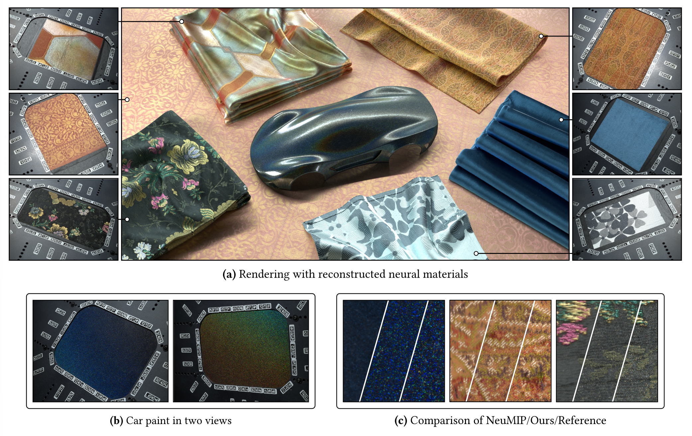

<h1 align="center">
  <a href="https://doi.org/10.1145/3829340.3842341">Procedural Neural Shading of Mesoscale Detail</a>
</h1>

<p align="center">
  <a href="https://doi.org/10.1145/3829340.3842341">
    
  </a>
</p>

<p align="center">
  SIGGRAPH Asia 2026 Conference Papers.
  <br />
  <a href="https://doeringc.de"><strong>Christian Döring</strong></a>
  ·
  <a href="https://merlin.nimierdavid.fr/"><strong>Merlin Nimier-David</strong></a>
  ·
  <a href="https://rgl.epfl.ch/people/wjakob"><strong>Wenzel Jakob</strong></a>
</p>

<p align="center">
  <a href="https://doi.org/10.1145/3829340.3842341">
    
  </a>
</p>

## Overview

This repository contains the implementation of the method described in:

> Christian Döring, Merlin Nimier-David, and Wenzel Jakob. 2026. **Procedural
> Neural Shading of Mesoscale Detail.** In SIGGRAPH Asia 2026 Conference Papers.

It uses the [Mitsuba 3](https://github.com/mitsuba-renderer/mitsuba3) renderer
and PyTorch to fit neural materials to gonioreflectometer captures in two
stages:

1. **Coarse:** our coarse model, inspired by
   [NeuMIP: Multi-Resolution Neural Materials](https://doi.org/10.1145/3450626.3459795)
   (Kuznetsov et al., 2021), learns the base appearance and parallax using a
   log-space mean squared error loss.
2. **Detail:** a procedural noise model learns fine-scale appearance using a
   style loss, while the coarse model remains frozen.

**Implementation note:** The original implementation incorrectly applied a
homography when mapping captured images to the material plane. This
implementation instead uses the calibrated camera geometry.

## Getting Started

### System requirements

The provided Pixi environment targets Linux x86-64 and an NVIDIA GPU with CUDA
support. It uses Python 3.12, Mitsuba 3.8.0, Dr.Jit 1.3.1, and PyTorch 2.11.0.
Dependencies are managed through `pixi.toml` and `pixi.lock`.

### Installation

Clone the repository and install the environment with [Pixi](https://pixi.sh/):

```bash
git clone https://github.com/rgl-epfl/procedural-neural-mesoscale-shading.git
cd procedural-neural-mesoscale-shading
pixi install
```

This installs Mitsuba and the Python dependencies. The default environment uses
the CUDA 12.9 build of PyTorch. A CUDA 12.6 environment is also available:

```bash
pixi install -e cu126
```

Use `pixi run -e cu126` in place of `pixi run` below to select that environment.

### Data

The captures are available on the
[dataset website](https://rgl-epfl.github.io/btf-data/).

Captures are downloaded automatically when a material is first used. Each
material has one archive (about 10–17 GB), downloaded to `$MESOSCALE_DATA` if
set, or `~/.cache/mesoscale/` otherwise. To download captures ahead of time,
run:

```bash
pixi run python -m datasets.download                  # all materials
pixi run python -m datasets.download fabric_hex alu   # selected materials
```

Interrupted downloads resume where they stopped. Archives are stored in
`.cache/` within the data directory and can be deleted after extraction to save
space. Each archive contains a single folder for its material:

```text
~/.cache/mesoscale/
  fabric_hex/
    dataset.json
    ... image files ...
  fabric_blue/
    dataset.json
    ... image files ...
```

Each material folder contains photographs and a `dataset.json` file describing
the camera poses and light positions. Set `MESOSCALE_DATA` or pass
`data_root=/path/to/data` to choose a different data directory. Pass
`data.download=false` to use existing captures without downloading missing data.

To train on your own captures in the same format, pass
`data.path=/path/to/capture`. These folders are never downloaded.

In Python:

```python
from datasets import Photos

Photos("fabric_hex")                        # released material, downloaded if missing
Photos("fabric_hex", root="/path/to/data")  # stored in /path/to/data/fabric_hex
Photos(path="/path/to/my_capture")          # your own captures
```

## Repository Structure

### Main scripts

- **`train.py`** — Train the coarse or detail stage and save a checkpoint.
- **`render_sweep.py`** — Render measured views alongside captured references.
- **`render_camera_sweep.py`** — Render full-frame camera sweeps.
- **`render_light_sweep.py`** — Render a fixed view under a rotating light.

### Core modules

- **`bsdfs/`** — Neural BSDFs, parallax offsets, and the detail model.
- **`textures/`** — Learnable latent textures and procedural Perlin noise.
- **`methods/`** — Coarse and detail training loops.
- **`datasets/`**, **`dataloaders/`** — Capture loading and download, and view
  caching.
- **`samplers/`** — Material-point and image-block sampling.
- **`losses/`** — MSE and feature-based style losses.
- **`mitsuba_bsdf.py`** — The `mesoscale` BSDF plugin for Mitsuba rendering.

### Configuration and utilities

- **`configs/`** — Hydra settings for materials, data, training, and rendering.
- **`render.py`**, **`torch_render.py`** — Rendering helpers.
- **`mlp_torch.py`** — Neural decoder.
- **`torch_bridge.py`** — Dr.Jit–PyTorch tensor conversions.

## Usage

### Training

Train the coarse model first, then initialise detail training from its
checkpoint:

```bash
pixi run train material=fabric_hex stage=coarse
pixi run train material=fabric_hex stage=detail \
    coarse=runs/fabric_hex_coarse/latest/checkpoint.pkl
```

Key settings:

- `material`: material configuration from `configs/material/`.
- `stage`: `coarse` or `detail`.
- `coarse`: coarse checkpoint required for detail training.
- `data_root`: folder for the released captures (default: `$MESOSCALE_DATA` or
  `~/.cache/mesoscale`).
- `data.path`: a folder of your own captures to use instead.
- `stage.method.n`: number of training iterations.
- `stage.method.lr`: learning rate.
- `seed`: random seed.
- `name`: output run name; defaults to `<material>_<stage>`.

Stage settings are in `configs/stage/`; general training settings are in
`configs/train.yaml`.

### Rendering

Render sweep views and their captured references:

```bash
pixi run render_sweep material=fabric_hex \
    chkpt=runs/fabric_hex_detail/latest/checkpoint.pkl
```

Key settings:

- `chkpt`: trained checkpoint.
- `renderer`: `mitsuba` (default) or `torch`. Use `torch` for GPUs without
  cooperative-vector support.
- `crop`: central crop as a percentage of material width: `100`, `25`, or `20`.
- `spp`: samples per pixel.
- `first`, `last`: view range `[first, last)`; `last=null` includes the
  remaining views.
- `exposure`: linear exposure multiplier for display images.

To render a camera sweep or a rotating-light sweep:

```bash
pixi run python render_camera_sweep.py material=fabric_hex \
    chkpt=runs/fabric_hex_detail/latest/checkpoint.pkl

pixi run python render_light_sweep.py material=fabric_hex \
    chkpt=runs/fabric_hex_detail/latest/checkpoint.pkl
```

Light-sweep settings include `view` for the initial camera and light pose,
`angle` for the light's rotation in degrees, and `frames` for the frame count.
See the corresponding `configs/render_*.yaml` files for all rendering settings.

### Output

Runs are saved to `runs/<name>/<datetime>/`, with `runs/<name>/latest` pointing
to the newest run of that name.

- **Training:** `checkpoint.pkl` contains the trained model and training state.
- **Reference sweeps:** `render/` and `reference/` contain matching EXR and PNG
  frames.
- **Camera and light sweeps:** the run directory contains EXR and JPEG frames.

EXR files store linear radiance. PNG and JPEG files store exposure-adjusted sRGB
images.

## Citation

If you use this code in your research, please cite:

```bibtex
@inproceedings{Doering2026Mesoscale,
    author = {D{\"o}ring, Christian and Nimier-David, Merlin and Jakob, Wenzel},
    title = {Procedural Neural Shading of Mesoscale Detail},
    booktitle = {SIGGRAPH Asia 2026 Conference Papers},
    year = {2026},
    publisher = {Association for Computing Machinery},
    doi = {10.1145/3829340.3842341},
    url = {https://doi.org/10.1145/3829340.3842341}
}
```
